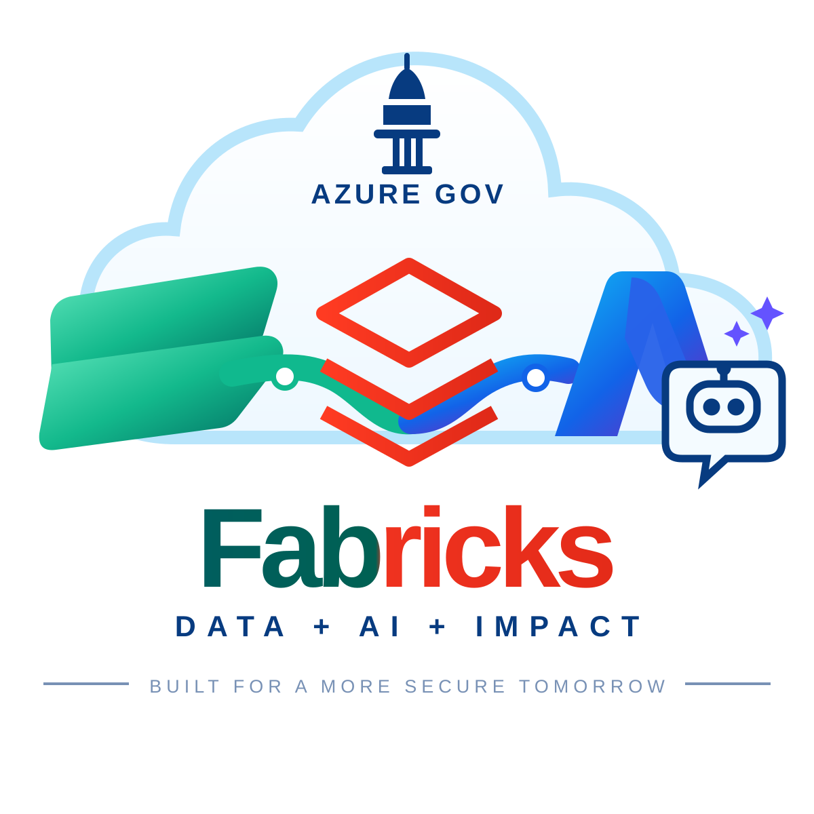
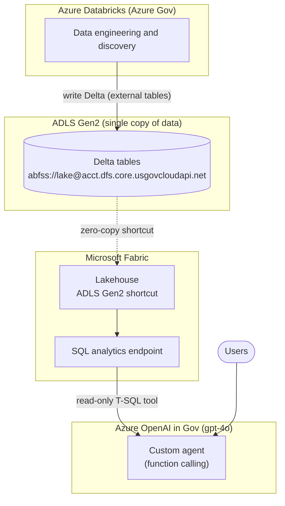

<p align="center">
  
</p>

# Databricks + Microsoft Fabric + Azure AI Foundry on Azure Government

**Proof-of-Concept Working Document** — DRAFT for customer review

> **Want to run it?** See [docs/GETTING-STARTED.md](docs/GETTING-STARTED.md) and [.env.example](.env.example).

## 1. Objective

Show that a team can:

1. Do all data engineering and discovery in **Azure Databricks**.
2. Store the results as **Delta tables in ADLS Gen2**, a single copy of the data.
3. Surface that data in **Microsoft Fabric** through an ADLS Gen2 **shortcut**, with no data copy.
4. Use **Azure AI Foundry** agents against that data.

All components run in **Azure Government**.

## 2. Target Architecture



## 3. Pre-flight Checks (complete first)

Each item can end or reshape the POC. Feature availability in Azure Government changes often; **verify against current Microsoft documentation** rather than relying on this document.

| # | Check | Status | Notes |
|---|-------|--------|-------|
| 1 | Fabric enabled in the Gov tenant; capacity available in a supported region (trial or F2 is sufficient) | ☐ | |
| 2 | ADLS Gen2 shortcuts available in Fabric Gov | ☐ | |
| 3 | Foundry (Agent Service) available in the target Gov region | ☒ | **Not available** in USGov Virginia; models are |
| 4 | Foundry **Fabric tool** and Fabric **data agent** supported in Gov | ☐ | Highest risk |
| 5 | Tenant admin settings enabled: create Fabric items, shortcuts | ☐ | |
| 6 | Required impact level (IL4/IL5) permits all services involved | ☐ | |

Use Gov endpoints: `*.dfs.core.usgovcloudapi.net`, `portal.azure.us`, and the Fabric Gov portal.

## 4. Setup Steps

### 4.1 ADLS Gen2
1. Create a storage account with **Hierarchical namespace** enabled and a container (e.g. `lake`).
2. For the POC, leave public network access open to avoid firewall complications. Add trusted workspace access or private endpoints later.
3. Path format: `abfss://lake@<acct>.dfs.core.usgovcloudapi.net/`.

### 4.2 Databricks
1. Create an Azure Databricks workspace in Gov.
2. Unity Catalog was not available in this Gov environment. Grant storage access with a **service principal (OAuth)** whose secret lives in Azure Key Vault, exposed through a Key Vault-backed Databricks secret scope (created at `<workspace-url>/#secrets/createScope`). Grant the AzureDatabricks app **Key Vault Secrets User** on the vault.
3. Configure the session and write a sample Delta table (Gov uses `login.microsoftonline.us` and `dfs.core.usgovcloudapi.net`):

```python
host   = "<acct>.dfs.core.usgovcloudapi.net"
tenant = "<tenant-id>"
spark.conf.set(f"fs.azure.account.auth.type.{host}", "OAuth")
spark.conf.set(f"fs.azure.account.oauth.provider.type.{host}",
               "org.apache.hadoop.fs.azurebfs.oauth2.ClientCredsTokenProvider")
spark.conf.set(f"fs.azure.account.oauth2.client.id.{host}", "<client-id>")
spark.conf.set(f"fs.azure.account.oauth2.client.secret.{host}",
               dbutils.secrets.get("<scope>", "<secret-name>"))
spark.conf.set(f"fs.azure.account.oauth2.client.endpoint.{host}",
               f"https://login.microsoftonline.us/{tenant}/oauth2/token")

path = f"abfss://<container>@{host}/<folder>/sales"
df = spark.range(100000).selectExpr("id", "id % 10 as region", "rand() as amount")
df.write.format("delta").mode("overwrite").save(path)
```

4. Compute: use a single-node cluster with an **x86** node type (for example `Standard_DS3_v2`). Arm-based sizes fail in Gov (see section 6).
5. Fabric compatibility: avoid or disable deletion vectors and column mapping, then confirm against current Fabric Delta support documentation:

```sql
ALTER TABLE delta.`<path>` SET TBLPROPERTIES ('delta.enableDeletionVectors' = false);
```

### 4.3 Fabric
1. Create a workspace on the capacity, then a **Lakehouse**.
2. Right-click **Tables** (or the `dbo` schema), choose **New shortcut**, then **Azure Data Lake Storage Gen2**.
   - URL: `https://<acct>.dfs.core.usgovcloudapi.net`
   - Subpath: the **Delta table folder itself** (the one containing `_delta_log`), for example `/<container>/<folder>/sales`. A shortcut to a parent folder lands in *Unidentified*, and a shortcut under Files is not registered as a table.
3. Authenticate with a service principal or organizational account. Grant that identity **Storage Blob Data Reader** on the storage account.
4. Confirm `sales` appears as a Delta table under **Tables**, not under *Unidentified*.
5. In a Fabric notebook:

```python
spark.sql("SELECT region, sum(amount) FROM <lakehouse>.sales GROUP BY region").show()
```

6. Write more rows in Databricks and re-query in Fabric to confirm the data stays current.

### 4.4 Foundry agent
Preferred path (commercial; likely unavailable in Gov, see section 6):
1. Create a Fabric **data agent** in the workspace and add the lakehouse tables. Test it in the Fabric UI.
2. Create a Foundry project connection to the Fabric workspace and attach the **Fabric tool** to a Foundry agent.

Gov path (verified available): deploy **gpt-4o** (Data Zone Standard, USGov) in a Foundry project and build the agent with **Azure OpenAI function calling**. The sample in [`agent/agent.py`](agent/agent.py) gives the model a `query_lakehouse` tool that runs read-only T-SQL against the lakehouse **SQL analytics endpoint** using service principal (Entra) authentication through `pyodbc` and ODBC Driver 18. The service principal must be a member of the Fabric workspace. This uses the same shortcut table and demonstrates the end-to-end story without the managed Agent Service or the native Fabric tool.

```bash
pip install -r agent/requirements.txt
export AZURE_OPENAI_API_KEY=...   # from Key Vault
export FABRIC_TENANT_ID=... FABRIC_CLIENT_ID=... FABRIC_CLIENT_SECRET=...
python agent/agent.py "What is the total amount by region?"
```

The SQL token audience (`FABRIC_SQL_SCOPE`) for Fabric Gov is unverified. Override it if authentication fails.

## 5. Demonstration Plan

1. Show the Delta table in ADLS written from Databricks (one copy of the data).
2. Show the same table in Fabric through the shortcut, with no data movement.
3. Write new rows in Databricks and show them appear in Fabric.
4. Ask the Foundry agent a natural-language question and show it answered from the data.
5. Present the findings log (section 6).

## 6. Findings Log (complete during POC)

| Area | Finding | Impact | Workaround |
|------|---------|--------|------------|
| Databricks compute | Arm-based node types (for example `Standard_D4plds_v6`) fail with `InvalidTemplateDeployment`: the `DatabricksWorkerArm64` image is not found | Cluster will not start | Use x86 node types |
| Databricks governance | Unity Catalog not available in this Gov environment | No storage credentials or external locations; governance falls to storage RBAC/ACLs and Purview | Service principal OAuth with a Key Vault-backed secret scope |
| Security / identity | SPN OAuth via Key Vault secret scope works against ADLS Gen2 (`login.microsoftonline.us`) | None | None needed |
| Delta / Fabric | Databricks-written Delta table is readable in Fabric through a Tables shortcut (verified with Spark SQL) | None | Shortcut must point at the table folder, not a parent |
| Freshness | A Databricks append (+1,000 rows) was visible in Fabric immediately with no refresh | None | None needed |
| Fabric Data agent / Copilot | Not visible in the Gov tenant; **pending confirmation** against Microsoft documentation | Foundry Fabric tool path likely blocked | Function tool over the SQL analytics endpoint |
| Foundry Agent Service | The Agents page in a USGov Virginia project reports "Unsupported region" and lists only commercial regions | Managed agents, threads and the Fabric tool are unavailable | Azure OpenAI function-calling agent (`agent/agent.py`) |
| Foundry models | gpt-4o 2024-11-20 deploys in USGov Virginia (Data Zone Standard); lifecycle shown as Legacy | Chat and function calling work | None needed |
| Networking | POC uses public access; no VNet injection or Secure Cluster Connectivity | Not suitable for production | Move to private networking for the MVP |

## 7. Security and Governance Considerations

- **Permission enforcement point.** Without Unity Catalog, storage RBAC/ACLs and Fabric workspace roles are the enforcement points.
- **Secrets.** Keep the service principal secret in Key Vault and read it through a Key Vault-backed secret scope. Never place it in notebooks.
- **Shortcut identity.** Use a service principal or workspace identity with least privilege (Storage Blob Data Reader).
- **Network isolation.** A storage firewall requires trusted workspace access, which requires an F SKU capacity. Private endpoints add further requirements.
- **Governance ownership.** Decide which system (for example Microsoft Purview plus storage ACLs) is the governance system of record.

## 8. Known Risks

| Risk | Mitigation |
|------|------------|
| Fabric or Foundry features lag in Gov | Complete section 3 first; use the fallback in 4.4 |
| Delta features unsupported by Fabric | Disable deletion vectors and column mapping; test early |
| Unity Catalog unavailable | Service principal OAuth, storage ACLs, Purview |
| Fabric data agent unavailable in Gov | Function tool over the SQL analytics endpoint |
| Firewalled storage | Trusted workspace access on an F SKU |

## 9. Questions for the Customer

1. Which system owns governance (Unity Catalog is unavailable here), for example Purview plus storage ACLs?
2. Are there network restrictions (private endpoints, firewall rules)?
3. Is write-back from Fabric to the lake required?
4. What impact level (IL4/IL5) applies?
5. Which Gov region and which data sets should the POC use?
6. What agent use cases and users matter most?

## 10. Next Steps

- [ ] Complete pre-flight checks (section 3)
- [ ] Build the POC (section 4)
- [ ] Record findings (section 6)
- [ ] Review with the customer and scope the MVP

## 11. Chat over the Lakehouse shortcut (POC)

`chat/` is a local Q&A page that proves Lakehouse shortcuts work as a source for an AI chat app. It reads two shortcuts: `Files/bronze/callrecords` (Teams call records) and the Databricks-written `Tables/dbo/sales` Delta table (section 12). The server lists and reads the newest version of each Teams call record through the OneLake API at the shortcut path, pseudonymizes it with `scripts/flatten_samples.py`, loads it into in-memory SQLite, reads the Sales Delta table the same way (replays `_delta_log` to find the active parquet files, then reads them with `pyarrow`) into a `Sales` table, and lets Azure OpenAI answer by running read-only `SELECT`s. Each answer shows the SQL, the exact files read, and a **heuristic confidence score** (query success, answer numbers found in the results, source completeness such as NULL stream metrics). The score is not a measured accuracy.

```bash
.venv/bin/pip install -r chat/requirements.txt
export FABRIC_TENANT_ID=<tenant> FABRIC_CLIENT_ID=<client> FABRIC_CLIENT_SECRET=<from a secret store>
export ONELAKE_HOST=<onelake-dfs-host> FABRIC_WORKSPACE=<workspace> FABRIC_LAKEHOUSE=<lakehouse>
export FABRIC_SQL_SERVER=<sql-endpoint-host> FABRIC_DATABASE=<lakehouse>   # agent only; keep all of these in ~/.bashrc
export AZURE_OPENAI_ENDPOINT=<endpoint> AZURE_OPENAI_API_KEY=<key>
.venv/bin/python -m chat.server --check   # reads the shortcut only; no model needed
.venv/bin/python -m chat.server           # http://127.0.0.1:8000
.venv/bin/python -m unittest tests.test_chat
```

The server binds to localhost only. Optional overrides: `SALES_TABLE` (`dbo/sales`), `AZURE_OPENAI_DEPLOYMENT`, `CHAT_PORT`. The call-record data is produced by the separate `cqd` ingest pipeline, and the `sales` table by the Databricks notebook in section 12. The chat app, its tests, and the sample agent all live in this repo, which only reads the data.

## 12. Sales data (Databricks-written Delta table shortcut)

This is the table that proves the Databricks → ADLS → Fabric path. It is synthetic POC data, not customer data. Both `agent/agent.py` (SQL analytics endpoint) and the chat app in section 11 (OneLake read of the shortcut) can answer questions about it, for example "What is the total amount by region?". If the table can't be read (for example a checkpointed Delta log or deletion vectors), the chat app still serves call questions and shows the reason in its source line.

| Item | Value |
|------|-------|
| Written by | Databricks notebook (single-node x86 cluster), service principal OAuth, Key Vault-backed secret scope |
| ADLS location | `abfss://bronze@<storage-account>.dfs.core.usgovcloudapi.net/dbx_poc/sales` (Delta) |
| Fabric shortcut | ADLS Gen2 shortcut named `sales` under **Tables → dbo** in your lakehouse and workspace, pointing at `/bronze/dbx_poc/sales` |
| Columns | `id` (bigint), `region` (bigint, 0–9), `amount` (double, 0–1) |
| Rows | 101,000: an initial 100,000 plus a 1,000-row append (10,100 per region) |
| Source code | `spark.range(n).selectExpr("id", "id % 10 as region", "rand() as amount")` |

Verified results:
- Fabric Spark SQL read all 100,000 rows (10,000 per region, about 5,000 total amount each).
- After a Databricks append of 1,000 rows, Fabric showed 10,100 per region with no refresh or copy.
- The same lakehouse also holds the `silver_*` and `gold_*` call-record tables, and `Files/bronze/callrecords` (section 11) is a separate shortcut to the call-record JSON.

Shortcut rule: the Tables shortcut must point at the Delta table folder itself (the one containing `_delta_log`). Pointing at the parent `dbx_poc` folder lands in *Unidentified*.
