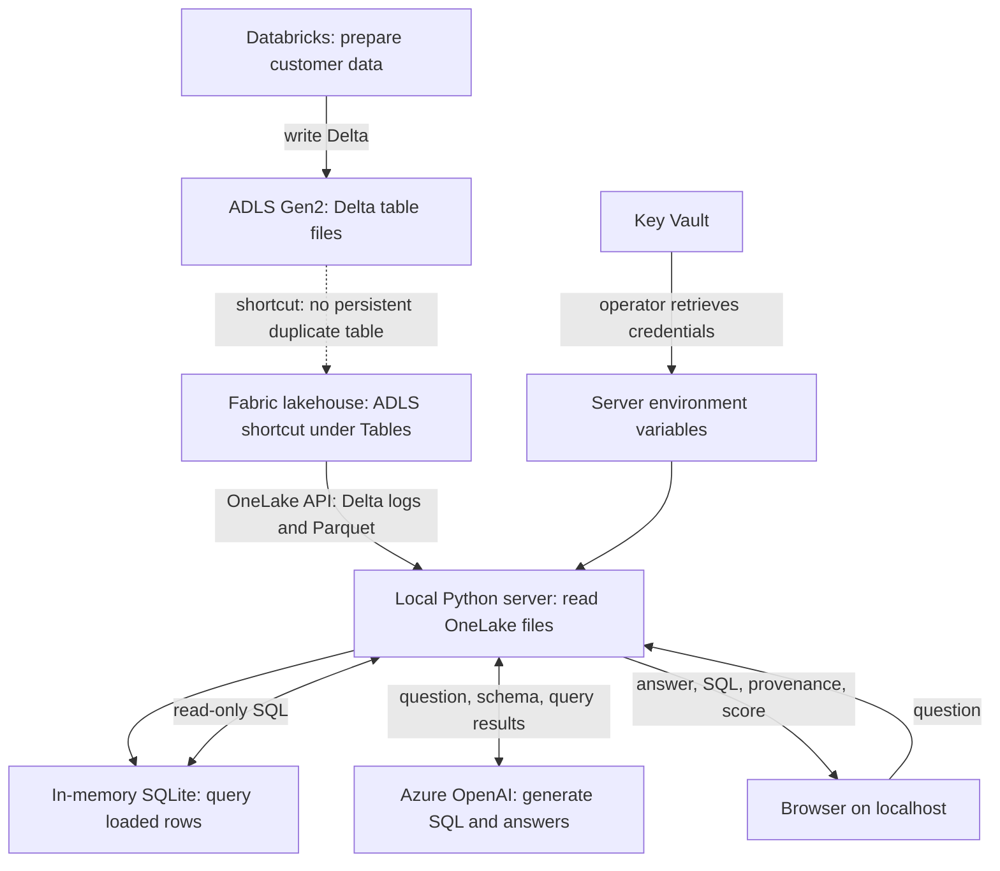

# Customer deployment and adaptation guide

Build a proof of concept that answers natural-language questions about your own Delta tables using Databricks, ADLS Gen2, Microsoft Fabric, and Azure OpenAI.

This guide covers the **local web chat application** in `chat/`. You do not need the original sales or Teams call-quality datasets. You do need to adapt the sample's table selection and business instructions for your data; this is not yet a configuration-only connector for arbitrary datasets.

The repository provides application code, not automated provisioning of the Azure resources or an upstream data-engineering pipeline. The steps below are a manual deployment path.

## 1. Understand the deployed architecture



**What "one copy" means:** the Fabric shortcut references the existing ADLS table without importing another persistent table. The chat server still downloads the active files and creates an in-memory copy for querying. Query results and schema information are sent to Azure OpenAI to produce the answer.

The optional command-line sample in [`agent/agent.py`](../agent/agent.py) uses a different path: Azure OpenAI function calling over the Fabric **SQL analytics endpoint** with T-SQL and ODBC. It is not the backend for the web chat page. Neither sample requires a managed Foundry Agent Service or a Fabric Data Agent.

### Application components

| File | Responsibility |
|------|----------------|
| [`chat/source.py`](../chat/source.py) | Authenticate to OneLake, discover tables, replay Delta commits, download Parquet, and populate SQLite |
| [`chat/engine.py`](../chat/engine.py) | Describe the schema to the model, execute read-only SQLite queries, and calculate the heuristic score |
| [`chat/server.py`](../chat/server.py) | Read environment settings, cache data, and serve the page and API |
| [`chat/index.html`](../chat/index.html) | Display questions, answers, SQL, provenance, and scores |

## 2. Confirm prerequisites and cloud support

Before provisioning, confirm with your administrators:

- An Azure subscription and Microsoft Entra tenant appropriate for the data.
- Databricks and ADLS Gen2 availability in the chosen region.
- A Fabric-enabled tenant, a supported capacity, and permission to create a workspace, lakehouse, and ADLS Gen2 shortcut. Keep the capacity **running**, not paused.
- An Azure OpenAI resource and a deployed chat model supporting function/tool calling.
- Permission to create application identities, assign storage roles, configure Fabric tenant settings, and manage Key Vault secrets.
- Network access from Databricks to ADLS and Key Vault, and from the application host to Entra, OneLake, Azure OpenAI, and Key Vault when loading secrets.
- Approval to send the selected schema and query-result data to the chosen model deployment.
- Python 3.10 or later, Git, and Azure CLI on the application host. ODBC is unnecessary for the web chat app.

**Cloud boundary:** the implementation is configured for Azure Government. It uses `AzureAuthorityHosts.AZURE_GOVERNMENT` in `chat/source.py` and the storage token scope `https://storage.azure.com/.default`. Government endpoints must be taken from your actual resources. Feature, model, identity, and networking support must be verified for your tenant and region; findings in the README describe the original POC, not universal availability guarantees.

For commercial Azure, review and change the credential authority in the code as well as the resource endpoints. For the optional SQL agent, also verify its SQL token scope and authority. Changing environment variables alone does not switch every cloud-specific setting.

For a Government deployment, select the CLI cloud before signing in:

```bash
az cloud set --name AzureUSGovernment
az login --tenant "<tenant-id>"
az account set --subscription "<subscription-id>"
```

Use the Government Azure portal at `https://portal.azure.us` and your tenant's Fabric portal.

## 3. Provision resources and identities

### 3.1 Create the data and AI resources

1. Create a resource group in the approved region.
2. Create an ADLS Gen2 storage account with **hierarchical namespace enabled**, then a container for the Delta tables.
3. Create a Databricks workspace and compute appropriate to your workload. The original POC used single-node x86 compute; choose a size supported in your region.
4. Create Key Vault for application credentials. See the Databricks permission-model caveat below before choosing a vault for a secret scope.
5. In your approved Azure AI management experience, create an Azure OpenAI resource and deploy a model supporting chat completions and tools. Record the **deployment name**, resource endpoint, and API-key location. The application defaults to deployment name `gpt-4o` and uses API version `2024-12-01-preview`; confirm compatibility before choosing a different deployment.
6. Provision or select Fabric capacity, assign a new workspace to it, and create a lakehouse. Record the workspace and lakehouse **names**.

Use existing approved resources instead where available. This guide does not require the names used in the original demo.

### 3.2 Create application identities

In Microsoft Entra **App registrations**, create an application for the chat reader. Record its directory/tenant ID and application/client ID. Under **Certificates & secrets**, create a client secret and store its **value**, not its secret ID, in Key Vault through an approved secret-entry workflow.

Use a separate identity for Databricks writes when possible. A third identity may be used for the Fabric shortcut's connection to ADLS. Separate identities make it possible to give each component only the access it needs.

| Identity | Required access for this POC | Where to configure |
|----------|------------------------------|--------------------|
| Databricks writer | `Storage Blob Data Contributor` on the target container or approved storage scope | Storage IAM; account for directory ACLs if using ACL-based authorization |
| Fabric shortcut connection | `Storage Blob Data Reader` on the target data | Storage IAM; configure the connection when creating the shortcut |
| Chat application service principal | Fabric workspace **Member**, as used by this POC | Fabric workspace **Manage access** |
| Authorized service-principal group | Inclusion in the applicable Fabric tenant setting permitting service principals to call Fabric APIs | Fabric admin portal; setting labels can vary |
| Operator loading app secrets | Permission to read the selected Key Vault secrets | Vault data-plane RBAC, such as `Key Vault Secrets User`, or `Get` access policy according to the vault's model |

Workspace Member is a broad POC assignment, not a least-privilege production recommendation. Validate a narrower supported data-read configuration before production. An Azure subscription role does not automatically grant Fabric workspace access, and workspace membership does not automatically grant access to the underlying ADLS account.

### 3.3 Store and expose secrets

Store the chat reader's client-secret value and the Azure OpenAI API key in Key Vault under names you choose, for example `chat-reader-secret` and `chat-openai-key`. The startup example below assumes each vault secret contains the **raw credential string**, not a JSON object.

The app reads environment variables. **It does not call Key Vault itself.** An operator or deployment platform must retrieve and inject secrets before launching it. `.bashrc` exports can provide variables for a local session, but putting literal credentials there creates plaintext copies outside Key Vault. Prefer runtime retrieval and never commit shell profiles or secret-bearing configuration.

For Databricks, prefer your organization's supported Unity Catalog storage configuration where available. The original POC used service-principal OAuth with a Key Vault-backed Databricks secret scope:

1. Follow the [Databricks secret-scope instructions](https://learn.microsoft.com/en-us/azure/databricks/security/secrets/) for your cloud.
2. **Key Vault-backed scopes require the Vault access policy permission model according to those instructions; assigning a Key Vault RBAC role alone is not sufficient.** Use a dedicated compatible vault if needed rather than changing a shared vault's permission model without review.
3. Configure the required Databricks service access to secrets (`Get` and `List`), vault networking, and scope ACLs.
4. Open `<databricks-workspace-url>#secrets/createScope`, enter the scope name, vault DNS name, and Azure resource ID, and restrict scope access to authorized users.
5. Verify the notebook can reference the writer secret using `dbutils.secrets.get`. Do not display the returned value.

## 4. Prepare a customer Delta table in Databricks

Use a small, approved, flat table for the initial test. The loader inserts Python values into SQLite directly; nested structs, arrays, maps, and other unsupported values need upstream flattening or explicit conversion before loading.

If you already have a compatible Delta table in ADLS, retain your existing pipeline and record the path containing its `_delta_log` folder.

For the service-principal OAuth path, configure a Databricks Python notebook with customer-specific identifiers, keeping the secret in the scope:

```python
storage_account = "<storage-account>"
container = "<container>"
tenant_id = "<tenant-id>"
writer_client_id = "<writer-client-id>"
host = f"{storage_account}.dfs.core.usgovcloudapi.net"

spark.conf.set(f"fs.azure.account.auth.type.{host}", "OAuth")
spark.conf.set(
    f"fs.azure.account.oauth.provider.type.{host}",
    "org.apache.hadoop.fs.azurebfs.oauth2.ClientCredsTokenProvider",
)
spark.conf.set(f"fs.azure.account.oauth2.client.id.{host}", writer_client_id)
spark.conf.set(
    f"fs.azure.account.oauth2.client.secret.{host}",
    dbutils.secrets.get("<scope-name>", "<writer-secret-name>"),
)
spark.conf.set(
    f"fs.azure.account.oauth2.client.endpoint.{host}",
    f"https://login.microsoftonline.us/{tenant_id}/oauth2/token",
)

# Replace with a DataFrame produced by your approved customer-data pipeline.
customer_df = spark.table("<source-table>")
table_path = f"abfss://{container}@{host}/curated/customer_data"

# Use a new destination for this initial test; do not overwrite existing data.
customer_df.write.format("delta").mode("errorifexists").option(
    "delta.enableDeletionVectors", "false"
).save(table_path)

spark.read.format("delta").load(table_path).printSchema()
print("Rows:", spark.read.format("delta").load(table_path).count())
```

Record a known row count and at least one independently calculated aggregate for later validation. Keep column names and data types simple for the first test.

### Delta reader limits

This application contains a lightweight reader, not a complete Delta engine:

- It requires consecutive JSON commits beginning at version 0. If earlier commits have been removed and checkpoint replay is required, it rejects the table. A checkpoint's existence alone is not the deciding factor.
- Active files with deletion vectors are rejected.
- Column mapping and partition-column reconstruction are not implemented. Start with an unpartitioned table without column mapping.
- It does not comprehensively validate all Delta protocol features. Confirm compatibility against the source before trusting answers; use a supported query engine for unsupported features.
- All active files and loaded rows are held in memory. Start small and measure resource use.

Do not delete logs or change production Delta features to accommodate the POC. Use a separate approved compatible test table, extend the reader, or use a supported query-engine path instead.

## 5. Connect the table to Fabric

1. Open the target lakehouse and create a new **ADLS Gen2 shortcut under Tables**, within the appropriate schema such as `dbo`.
2. Use storage URL `https://<storage-account>.dfs.core.usgovcloudapi.net`.
3. Set the subpath to the **table directory itself**, for example `/<container>/curated/customer_data`, not its parent directory.
4. Authenticate the shortcut connection using your approved identity with ADLS read access.
5. Give the shortcut a clear name, such as `customer_data`.
6. Confirm it appears as a Delta table under Tables, not Files or Unidentified.
7. Query it in a Fabric notebook and compare row counts and a known aggregate with Databricks.
8. Copy the table's OneLake path from Fabric. Extract the OneLake DFS hostname, workspace name, lakehouse name, and table path.

The web app constructs name-based paths:

```text
https://<ONELAKE_HOST>/<FABRIC_WORKSPACE>/<FABRIC_LAKEHOUSE>.Lakehouse/Tables/<table-path>
```

For example, `<table-path>` could be `dbo/customer_data`. Supply the hostname only for `ONELAKE_HOST`, without `https://` or a trailing path. Supply the lakehouse name without `.Lakehouse`. Do not substitute workspace/item GUIDs into this name-based construction without adapting the code.

## 6. Adapt the application to your data

Choose the single-table path first unless multiple tables are needed. Neither path requires the original Teams pipeline, which is not included in this repository.

### Path A: one customer table

This is the smallest adaptation:

1. Set `SALES_TABLE` to your actual table path, for example `dbo/customer_data`. Despite the setting's name, it can read a different compatible Delta schema.
2. The loader exposes that table inside SQLite as **`Sales`**, regardless of the shortcut name. You can retain this internal alias; it does not rename your source.
3. Set `LAKEHOUSE_SCHEMA` to the actual schema folder. The sample also discovers every `silver_*` and `gold_*` table there. To make this a single-table app, change `layer_tables()` in `chat/source.py` to return `[]`.
4. Replace `system_prompt()` in `chat/engine.py` with instructions for your domain. Keep dynamic schema discovery and the SQLite/read-only constraints. Remove all sample-specific claims about sales, calls, units, users, and joins.
5. Replace the example questions and dataset descriptions in `chat/index.html`, and the tool description in `chat/engine.py`. Update `sourceLine()` in the HTML so it labels the data as your dataset instead of sales.

An example replacement prompt for an order dataset is below. Change the business notes to match your actual columns, units, and meaning:

```python
def system_prompt(conn):
    return (
        "Answer questions about the customer's approved order dataset using run_sql.\n"
        "Tables (SQLite dialect, read-only SELECT statements):\n"
        + schema_text(conn)
        + "\nThe table named Sales is the internal alias for the customer order table. "
        "Each row represents one order. OrderTotal is in USD. "
        "Use only columns present in the schema. Do not invent joins or missing values. "
        "State only numbers returned by queries. "
        "If the data cannot answer the question, explain that limitation."
    )
```

This prompt is only an illustration: do not claim one row per order or USD units unless they are true for your data. The existing schema discovery provides column names, not a full business dictionary.

For unrelated datasets, also review `METRIC_REFERENCE`, the `stream_metric_coverage` calculation, and `score()` in the Python files. Those completeness checks contain call-quality assumptions and are not a general measure of customer-data quality.

### Path B: several customer tables

For multiple tables, make these additional code changes before running:

1. Replace `layer_tables()` in `chat/source.py` with explicit discovery of your approved table names. The current `silver_`/`gold_` prefix filter is sample behavior, not a universal discovery mechanism or authorization policy. Detect and report missing expected tables.
2. Keep the tables under the configured schema folder, or adapt path construction for multiple schemas. The current loader looks in one schema folder only.
3. If you do not need the separately loaded `Sales` alias, change the load expression in `State.data()` in `chat/server.py` to `source.load(self.src, include_sales=False)`. That expression handles both initial and forced refreshes.
4. Update HTML source labels and sample questions to remove the unused sales dataset.
5. Document each table's row grain, key columns, allowed joins, units, null semantics, and preferred aggregates in `system_prompt()`. Remove the original call-quality and synthetic-sales instructions.
6. Remove or adapt the special `silver_mediastreams` metric-coverage calculation and metric-related scoring rules when they do not describe your data.
7. Validate known answers across each table and each supported join.

The required code edits are deliberately explicit: this guide does not add a generic table-allowlist setting or per-user authorization that the implementation does not have.

## 7. Configure the application host

Clone the repository into an approved development environment, then install the web app dependencies:

```bash
git clone https://github.com/Coding-Forge/Fabricks.git
cd Fabricks
python3 -m venv .venv
.venv/bin/python -m pip install -r chat/requirements.txt
```

The following variables reflect what `chat/server.py` actually requires:

| Variable | Required | Value |
|----------|----------|-------|
| `FABRIC_TENANT_ID` | Yes | Reader identity's directory/tenant GUID |
| `FABRIC_CLIENT_ID` | Yes | Reader identity's application/client GUID |
| `FABRIC_CLIENT_SECRET` | Yes | Client-secret value injected at startup; `my_secret` is a legacy fallback |
| `ONELAKE_HOST` | Yes | Actual OneLake DFS hostname for your cloud |
| `FABRIC_WORKSPACE` | Yes | Workspace name |
| `FABRIC_LAKEHOUSE` | Yes | Lakehouse name, without item suffix |
| `AZURE_OPENAI_ENDPOINT` | For chat | Resource endpoint; Government commonly uses `https://<resource>.openai.azure.us/` |
| `AZURE_OPENAI_API_KEY` | For chat | Raw API key injected at startup |
| `AZURE_OPENAI_DEPLOYMENT` | No | Deployment name; default `gpt-4o` |
| `LAKEHOUSE_SCHEMA` | No | Discovery folder; default `dbo` |
| `SALES_TABLE` | No | Separate table path; default `dbo/sales`; internally aliased as `Sales` |
| `CHAT_PORT` | No | Local port; default `8000` |
| `CHAT_REFRESH_SECONDS` | No | Data-cache reuse interval; default `300` seconds |

The data-only `--check` does not require OpenAI credentials. `FABRIC_SQL_SERVER` and `FABRIC_DATABASE` are used only by the optional SQL agent.

In a Bash session already authenticated to the correct Azure cloud and tenant, set non-secret configuration and retrieve secrets without printing them:

```bash
export FABRIC_TENANT_ID="<tenant-id>"
export FABRIC_CLIENT_ID="<reader-client-id>"
export ONELAKE_HOST="<your-onelake-dfs-host>"
export FABRIC_WORKSPACE="<workspace-name>"
export FABRIC_LAKEHOUSE="<lakehouse-name>"
export LAKEHOUSE_SCHEMA="dbo"
export SALES_TABLE="dbo/customer_data"
export AZURE_OPENAI_ENDPOINT="https://<resource>.openai.azure.us/"
export AZURE_OPENAI_DEPLOYMENT="<deployment-name>"
export CHAT_PORT="8001"

KEY_VAULT_NAME="<application-vault-name>"
FABRIC_CLIENT_SECRET="$(az keyvault secret show \
    --vault-name "$KEY_VAULT_NAME" --name "chat-reader-secret" \
    --query value --output tsv --only-show-errors)" || exit 1
AZURE_OPENAI_API_KEY="$(az keyvault secret show \
    --vault-name "$KEY_VAULT_NAME" --name "chat-openai-key" \
    --query value --output tsv --only-show-errors)" || exit 1
test -n "$FABRIC_CLIENT_SECRET" && test -n "$AZURE_OPENAI_API_KEY" || exit 1
export FABRIC_CLIENT_SECRET AZURE_OPENAI_API_KEY
```

Replace all placeholders before running. Do not enable shell tracing (`set -x`), print credentials, or capture them in terminal recordings. If your vault stores JSON credentials, explicitly extract the credential field before export; passing the JSON object itself causes authentication failures.

You may alternatively use the ignored `.env` file described in [Getting Started](GETTING-STARTED.md). Replace its placeholders with correctly quoted shell values before sourcing it; the template is not executable as supplied. The application does not automatically load `.env`. Environment variables are a delivery mechanism, not a secret store, and remain accessible to suitably privileged processes.

## 8. Validate data before testing AI

Run this in the same shell as the configuration:

```bash
.venv/bin/python -m chat.server --check
```

For Path A, require `sales_rows` to match your known count and `sales_error` to be null. Zero Silver/Gold tables is expected when you intentionally disabled their discovery. For Path B, require every expected table to be listed and to have the expected count and no error.

**Do not use exit status or null errors alone as proof of connectivity.** The current loader can treat a missing directory/404 as an empty listing, and it does not create SQLite tables for empty datasets. It can therefore finish without a fatal error even though no usable data was loaded. Check expected table names, positive counts for your initial nonempty test dataset, and source paths.

Next, run the tests and launch:

```bash
.venv/bin/python -m unittest tests.test_chat
.venv/bin/python -u -m chat.server
```

The existing tests cover the original loader and scoring behavior. If you changed discovery, sample-specific behavior tests may need updating. Add focused tests for your table selection and domain adaptations; passing the original tests alone does not validate customer-data semantics.

Open `http://127.0.0.1:8001` when using the port above. The server binds to localhost. For a remote VS Code session, forward port **8001** in the Ports tab and open its forwarded address. Do not expose this unauthenticated POC publicly.

Use an acceptance checklist:

- Ask for the known row count and compare it with Databricks/Fabric.
- Ask for a known grouped aggregate and inspect the generated SQLite SQL.
- Confirm results use your actual columns and units, not the sample domain.
- Inspect source paths, row counts, errors, and Delta versions.
- Ask an unanswerable question and verify the app explains the limitation.
- Confirm excluded tables are not loaded or offered to the query tool.

An HTTP 200 response or a fluent answer is not proof of a successful data-backed answer.

## 9. Demonstrate freshness

1. In your approved upstream workflow, append a small, known set of test records to the Delta table.
2. Confirm Databricks and Fabric can read the expected new count.
3. Click **Refresh** in the chat page to reload files and in-memory tables.
4. Submit a **new** count question and compare the result.

The cache is refreshed on demand after `CHAT_REFRESH_SECONDS` has elapsed, or immediately through Refresh. It is not a continuous background synchronization service. Existing answer cards keep their original answers and scores.

## 10. Troubleshooting

| Symptom | Check |
|---------|-------|
| Zero tables/rows, or `no such table` | Resume Fabric capacity, verify exact OneLake paths, confirm Tables rather than Files shortcuts, then force Refresh. Null errors do not rule out an empty/404 listing. |
| 401/403 or authentication failure | Correct cloud/tenant, unexpired secret **value**, reader workspace membership, tenant service-principal setting, shortcut ADLS identity permissions, and networking. Allow time for permission propagation. |
| OpenAI authentication failure | Endpoint and key belong to the same resource; environment holds a raw key rather than a JSON wrapper. |
| Deployment or API errors | Deployment name, tool-calling support, API-version compatibility, quota, and regional/cloud availability. |
| Checkpoint or deletion-vector error | Reader compatibility; do not modify production logs. Use a compatible test table or a supported query engine. |
| Unsupported values on SQLite insert | Flatten/convert nested or unsupported source types before loading. |
| Wrong business answer | Inspect SQL, joins, grain, units, nulls, and prompt instructions against independently verified results. |
| Low confidence | Expand the query errors and scoring components. No result rows cap the score at 20; truncation, unmatched answer numbers, or sample metric-coverage rules can also lower it. |
| High confidence but incorrect interpretation | The heuristic checks query execution and numeric overlap, not full semantic correctness. Validate business logic independently. |
| Stale results after capacity resume or upstream write | Force Refresh and ask again; check the new load time and counts. |
| Browser shows a directory listing or unrelated page | Wrong local/forwarded port. Choose a free `CHAT_PORT`, restart, and update the browser/VS Code forwarding. |
| Settings or Python changes have no effect | Restart the server from the updated environment. Refresh reloads data, not Python code or credentials. |

## 11. Governance and production boundaries

This is a local POC, not a production-ready governed chat service:

- There is no end-user sign-in or per-person authorization. Every visitor uses the same server-side data access.
- The model receives schema information and query results. Review data-handling requirements before loading sensitive data.
- Source permissions apply to the shared identities. SQL-endpoint row-level security does not automatically govern a direct OneLake file read and local SQLite copy.
- Prompts, read-only SQL checks, and table-discovery filters do not replace authorization or policy enforcement.
- Restrict data **before** it reaches the model and its executable query context. For production, design authenticated user access, enforceable table/row/column policy, result suppression where required, and protected audit logs.
- Use an approved hosting platform, HTTPS, private networking where required, secret rotation, resource limits, monitoring, and a supported scalable query engine.
- The confidence score is a heuristic, not measured accuracy, a security decision, or permission to release an answer.

Government deployment alone does not establish a compliance authorization or impact-level approval. Confirm your organization's requirements for every service, host, connection, and data flow.

## References

- [Azure Government CLI setup](https://learn.microsoft.com/en-us/azure/azure-government/documentation-government-get-started-connect-with-cli)
- [Databricks secret scopes and Key Vault permission-model requirements](https://learn.microsoft.com/en-us/azure/databricks/security/secrets/)
- [Key Vault data-plane RBAC](https://learn.microsoft.com/en-us/azure/key-vault/general/rbac-guide)
- [OneLake API addressing](https://learn.microsoft.com/en-us/fabric/onelake/onelake-access-api)
- [ADLS Gen2 shortcuts](https://learn.microsoft.com/en-us/fabric/onelake/create-adls-shortcut)
- [Original POC architecture and findings](../README.md)
- [Quick-start commands](GETTING-STARTED.md)
